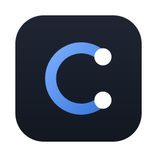
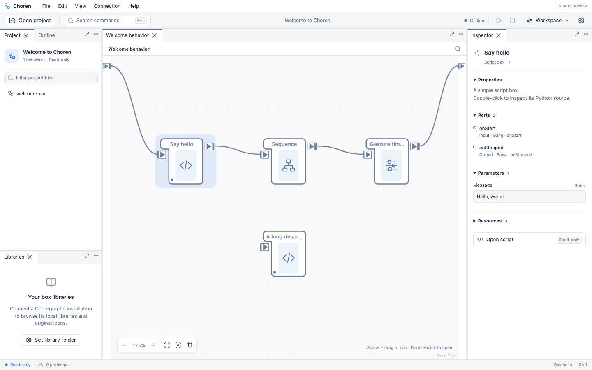
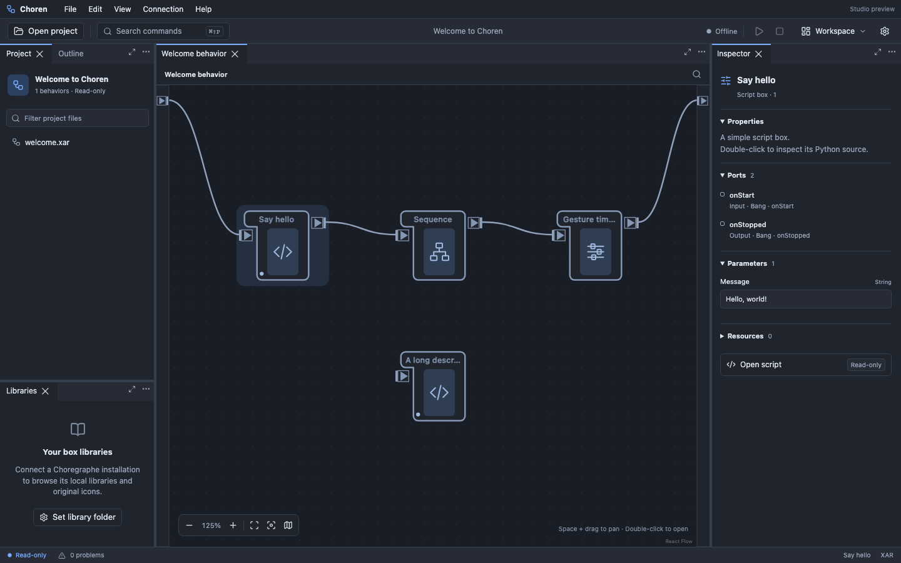

<div align="center">



# Choren

**A modern, open-source studio for NAO robot behaviors, compatible with Choregraphe projects.**

Open, edit and save `.pml` projects, `.crg` archives and `.xar` behaviors, run them on a
built-in virtual NAO 6, and connect to real robots.

[](https://github.com/daiyk/Choren/releases)
[](https://github.com/daiyk/Choren/actions/workflows/release.yml)
[](LICENSE)
[](https://github.com/daiyk/Choren/stargazers)
[](https://github.com/daiyk/Choren/commits/main)


</div>

<p align="center">
  
</p>

## At a glance

| | |
|---|---|
| 🦀 **Rust** | ~18.9k lines across four crates and the native shell |
| ⚛️ **TypeScript / React** | ~17.1k lines of studio UI |
| 🐍 **Python** | Box-script host and `naoqi` / `qi` compatibility modules |
| ✅ **Tests** | 125 Rust · 104 Playwright UI · 38 Vitest · Python host tests |
| 🤖 **Virtual robot** | NAO 6 over the libqi wire protocol, with a schema of 108 NAOqi 2.8 services |
| 📦 **Box library** | 11 original Choren boxes in 7 categories, plus your own Choregraphe libraries |

## Features

- **Choregraphe-compatible files.** Reads and writes `.pml`, `.crg` and `.xar`, keeping
  imported coordinates, port semantics and link geometry so saved files stay compatible.
- **Visual authoring.** Dockable workspace with flow diagrams, timelines, an inspector, an
  outline, undo/redo backed by the project history, and a CodeMirror Python script editor.
- **Virtual NAO 6.** Run behaviors without hardware. Box scripts run in a real Python host
  against a simulated NAOqi that speaks libqi (QiMessaging), the protocol real robots use.
- **Real robots.** Discover and connect to NAO over the network (port 9561 by default),
  browse robot files over SFTP, watch memory keys and filter robot logs.
- **Light and dark themes**, scalable text, native menus and signed auto-updates on macOS.

<p align="center">
  
</p>

## Repository layout

| Path | What's inside |
|---|---|
| [`app/`](app) | Desktop studio (Tauri 2, React 19). See [app/README.md](app/README.md). |
| [`crates/choren-core`](crates/choren-core) | Project model, validation rules and the edit engine |
| [`crates/choren-qi`](crates/choren-qi) | libqi (QiMessaging) protocol: client, server, values, signatures |
| [`crates/choren-naoqi`](crates/choren-naoqi) | Virtual robot and behavior runtime |
| [`crates/choren-robot`](crates/choren-robot) | Robot descriptors and posture data |
| [`python/choren_host`](python/choren_host) | Python host that runs box scripts |
| [`library/choren`](library/choren) | Choren's own starter box library |

## Getting started

Prerequisites: Node 24, a recent stable Rust, the
[Tauri prerequisites](https://tauri.app/start/prerequisites/) for your OS, and Python 3.8+
as `python3` on `PATH` for running behaviors on the virtual robot.

```sh
cd app
npm ci
npm run tauri dev
```

Run the test suites:

```sh
cargo test --workspace                              # from the repo root
cd app && npm test && npm run test:ui               # unit and browser UI tests
python3 -m unittest discover -s python/tests        # from the repo root
```

To use Choregraphe's robot meshes, box library and icons, point **Settings** at your own
Choregraphe installation. See [app/README.md](app/README.md) for the full feature tour and
development notes.

## ⚖️ Legal

Choren is an independent open-source project that is built to stay on the right side of the
law:

- **No Choregraphe code or assets are distributed.** This repository contains no
  Choregraphe source code, binaries, robot meshes, icons or box library. Those stay in the
  user's own Choregraphe installation and are loaded from there only if the user points
  Choren at it.
- **Original implementation for interoperability.** Choren's code is its own. It implements
  the Choregraphe file formats and the NAOqi messaging protocol so that people can keep
  working with the projects and robots they already have.
- **Open-source foundations.** [`crates/choren-qi`](crates/choren-qi) is based on
  [libqi](https://github.com/aldebaran/libqi), © 2011-2014 Aldebaran Robotics, released
  under the BSD 3-Clause License; its notice is kept in
  [`crates/choren-qi/LICENSE-libqi`](crates/choren-qi/LICENSE-libqi). All other
  dependencies are used under their own open-source licenses.
- **Trademarks.** Choren is not affiliated with, endorsed by or sponsored by Aldebaran,
  SoftBank Robotics or SoftBank Group. Choregraphe, NAO, NAOqi and Pepper are trademarks of
  their respective owners and are used here only to describe compatibility.

If you hold rights in any of the above and have a concern, please
[open an issue](https://github.com/daiyk/Choren/issues) and it will be addressed promptly.

## License

Choren is released under the [MIT License](LICENSE).

## Star history

<a href="https://star-history.com/#daiyk/Choren&Date">
  
</a>
